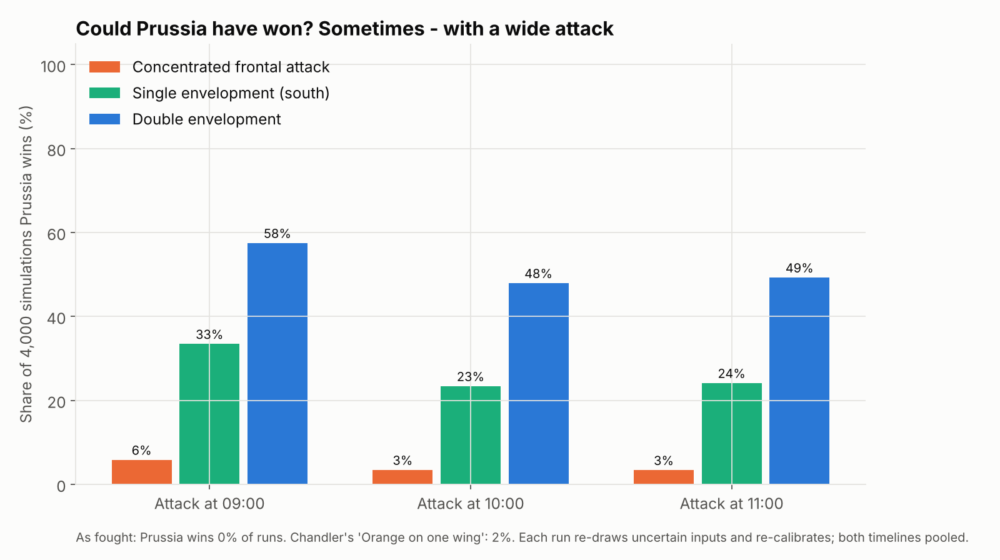
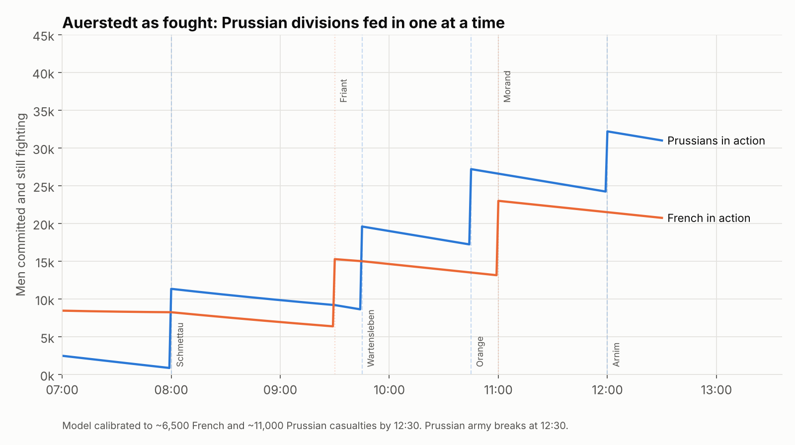
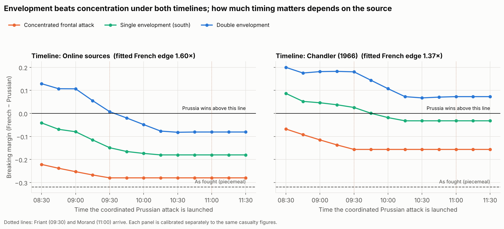
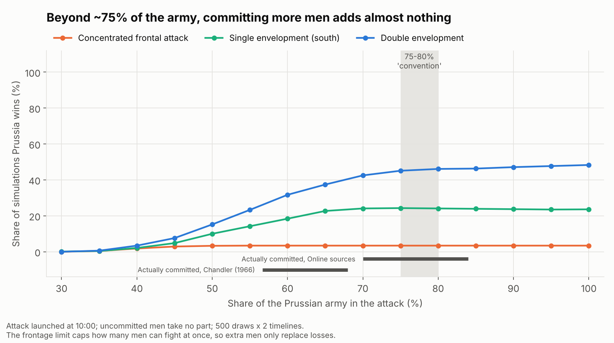
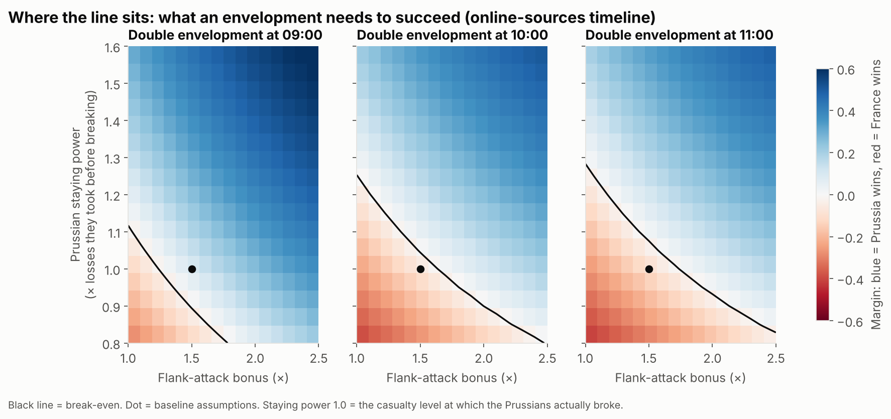

# Auerstedt 1806 — could the Prussians have won? A Lanchester model

On 14 October 1806, Marshal Davout's III Corps (~27,000 men) defeated the main Prussian army (~50,000–63,000 men, depending on the source) at Auerstedt. The Prussians had roughly a **2 : 1** numerical advantage and lost anyway.

This project asks a narrow question with a simple, transparent model:

> **If the Prussians had used their numbers differently — concentrating, or enveloping one or both French flanks — would a Lanchester-type attrition model predict a Prussian victory?**



## Short answer

Share of simulations Prussia wins, by when the coordinated attack is launched. The sources disagree on the timeline (see [Two timelines](#two-timelines-online-sources-vs-chandler)), so each one is shown, plus both pooled:

| Prussian course of action | Timeline | 09:00 | 10:00 | 11:00 |
|---|---|---|---|---|
| As fought (divisions fed in one at a time) | both | 0% | – | – |
| Chandler's counterfactual: Orange's whole division on one wing | both | – | – | 2% |
| Concentrated frontal attack | online / Chandler | 1% / 11% | 0% / 7% | 0% / 7% |
| Single envelopment (French left/south) | online / Chandler | 23% / 44% | 10% / 37% | 10% / 38% |
| Double envelopment | online / Chandler | 51% / 64% | 34% / 62% | 35% / 64% |
| **Double envelopment** | **pooled** | **58%** | **48%** | **49%** |

*2,000 random draws, each run under both timelines. Every run re-draws the uncertain inputs (troop numbers, casualty figures, frontage, morale) and re-calibrates the model. Exact numbers are in [`results/summary.md`](results/summary.md).*

What the model suggests, under its assumptions:

1. **Piecemeal commitment was fatal.** Fed in one division at a time, the Prussians never won a single run.
2. **Simply massing more men on the same front helped little** (≤11% wins), because the ground around Hassenhausen only let a limited number of men fight at once. Extra battalions waited in the rear instead of adding firepower.
3. **A double envelopment was the best course**, winning roughly half the runs. A single envelopment came second.
4. **How much timing mattered depends on whose timeline you believe.** On the timeline built from online sources, waiting past ~09:30 roughly halved the double envelopment's chances. On Chandler's timeline it made little difference.

So the honest headline is **"better tactics could plausibly have won it, but it was not a sure thing"** — not "better tactics would have won".

## How the model works (plain language)

**Lanchester's square law (1916).** Each side loses men at a rate proportional to the number of enemy soldiers firing at it:

```
dP/dt = −β · F      (Prussians lose men to French fire)
dF/dt = −α · P      (French lose men to Prussian fire)
```

`α` and `β` measure how effective one soldier is. The "square law" name comes from the result that a side's fighting strength grows with the **square** of its numbers — which is why concentrating your force matters so much.

On its own, the square law is too simple for a Napoleonic battle, so three ingredients are added:

| Ingredient | Why | In the code |
|---|---|---|
| **Frontage limit** | Only ~3,000–4,500 men per km of front can actually fight at once; the rest are supports. | `Params.density`, `Params.width` |
| **Three sectors** (front, north flank, south flank) | Attacking a flank opens extra frontage, so more of your men can fight. Flank attackers also get an effectiveness bonus (enfilade fire, disorder). | `SECTORS`, `Params.flank_bonus` |
| **Breakpoints** | Armies retreat long before they are wiped out. A side breaks when its losses reach a set level. | `Params.break_prussian`, `Params.break_french` |

The French defender is given **perfect interior lines**: at every minute Davout re-spreads his men in proportion to the Prussian threat in each sector. That is generous to the French on purpose.

### Calibration: where α and β come from

The two effectiveness numbers are not guessed. They are fitted so that the *historical* scenario (Prussian divisions arriving and attacking at their real times) reproduces the recorded casualties by about 12:30, when the Prussian army gave way.



Result: **each French soldier in contact was about 1.4–1.6× as effective as a Prussian one**, depending on the timeline. In a pure square-law fight, that means Prussia needed only about a 1.2–1.3 : 1 advantage to win. They had 1.83 : 1. The problem was getting those numbers into the fight.

| Timeline | French edge per man (β/α) | Square-law break-even ratio |
|---|---|---|
| Online sources | 1.60× | 1.26 : 1 |
| Chandler (1966) | 1.37× | 1.17 : 1 |

Important caveat: two unknowns fitted to two numbers is a *fit*, not a *test*. The model reproduces history because it was made to.

### The counterfactual rules

To keep the "what if" fair:

- Prussian divisions cannot arrive earlier than they historically could (they marched in column down one road).
- French divisions arrive exactly as in history (Friant ~09:30, Morand ~11:00).
- Flanking columns need extra marching time (30–75 minutes) before they engage.
- The Prussians break at the same casualty level at which they actually broke (−10% to +20%) — i.e. better tactics are **not** assumed to make them braver.

## Two timelines: online sources vs. Chandler

The model's inputs were first assembled from online sources. They were then checked against David Chandler's *The Campaigns of Napoleon* (1966, Auerstedt account pp. 489–495 by the book's index). Chandler agrees on almost every number:

| Item | Model input | Chandler |
|---|---|---|
| Davout's corps | 27,255 | 27,000 (26,000 in one place) |
| Prussian army | 50,000 (Monte Carlo: 50,000–60,000) | 60,000 with 230 guns in the text; 50,000 on his map |
| Gudin in contact | 07:00 | 07:00 |
| Friant deploys | 09:30 | ~09:30 |
| Morand arrives | 11:00 | 11:00 |
| Prussian withdrawal | 12:30 | 12:30 |
| French losses | 5,600–7,052 | 258 officers + 6,794 men = 7,052; Gudin lost >40% |
| Prussian losses | 9,000–13,000 killed and wounded | 10,000 "killed", 3,000 prisoners, 115 guns |
| Unused Prussian reserve | Kuhnheim (Guard), ~8,000 | "14 battalions, 5 squadrons and 3 batteries" |

He differs on **when the Prussian infantry actually attacked**, and that turns out to matter:

- **Online sources** have Schmettau fighting from about 08:00, Wartensleben from about 09:45, Orange from about 10:45, and part of the reserve (Arnim) engaged around noon.
- **Chandler** has Schmettau in position at 08:00, but the fighting until 09:45 is only "a skirmish between the light infantry screens" and Blücher's premature cavalry charges. Wartensleben's column was "badly entangled with convoys of baggage". Schmettau and Wartensleben attacked together at 09:45, Orange appeared at 11:00, and the reserve was not engaged before 12:30.

On Chandler's timeline, the Prussians inflicted the same casualties in less fighting time. So the calibration makes them more effective (French edge 1.37× instead of 1.60×), which improves every Prussian alternative. The truth is probably between the two. Chandler's version ignores casualties from the 08:00–09:45 skirmishing and artillery fire, so it probably overstates Prussian effectiveness somewhat. The online version treats Schmettau as fully engaged from 08:00, so it probably understates it.



### Chandler's own counterfactual, and why the model does not confirm it

Chandler writes that the Prussians wasted the chance to turn the open southern flank, launching "four fruitless direct assaults on the village" of Hassenhausen instead. He also judges that if Orange had committed his whole division on one wing instead of splitting it, "it is very probable that this would have tipped the balance of the battle in the Prussian favor."

The model gives that counterfactual only a **2%** chance. This is a limitation of the model, not a refutation of Chandler. The model gives Davout perfect interior lines: it re-spreads his men every minute to match the threat in each sector. So it cannot represent what Chandler describes, a southern flank held by a single regiment that Wartensleben routed at about 10:00. Testing Chandler's claim properly would need a model where the French take time to shift troops between sectors.

### Frontage: a rough check from Chandler's map

Chandler's battle map (scale bar in miles) shows the French line from Friant's division in the north to Rehausen in the south. Measured roughly off the scale bar, it spans about 2.4 miles (~3.9 km). Chandler also notes that 30 Prussian squadrons on the southern flank were "cramped into too narrow a space with no room to maneuver". Both fit the model's frontal width of 3.0–4.5 km. The map is schematic and low-resolution, so this is a consistency check, not a measurement.

## How much of the army should have attacked?

A common rule of thumb is to commit about **75–80%** of an army and hold **10–15%** in reserve. I could not find a source that sets out this exact ratio as Napoleonic or Prussian doctrine, so it is treated here as an assumption to test. Chandler describes Napoleon holding back a *masse de décision* to throw in at the crisis, but he gives no fixed share.

The model was re-run with 75–80% of the 50,000–60,000-man army in the main attack and 10–15% in reserve. The rest are detachments, baggage guards and stragglers. Two uses of the reserve were tried: **held back** (it never fights), or **thrown in later**, repeating the same plan 1–2 hours after the main attack.

| Strategy | Online sources, 75–80% committed | Online sources, everyone committed | Chandler, 75–80% committed | Chandler, everyone committed |
|---|---|---|---|---|
| As fought (piecemeal) | 0% | 0% | 0% | 0% |
| Concentrated frontal, 09:00 | 1% | 1% | 11% | 11% |
| Single envelopment, 09:00 | 24% | 23% | 44% | 44% |
| Double envelopment, 09:00 | 49–50% | 51% | 61–63% | 64% |

*Ranges cover the two reserve modes. Full tables, including 10:00 and 11:00, are in [`results/summary.md`](results/summary.md).*

**Answer: following the convention would not have changed the outcome.** Committing 75–80% instead of everything costs at most about 4 points of win probability. Using the reserve as a second blow gains nothing measurable. There are three reasons:

1. **The Prussians were already near the convention.** In this model they actually committed about 70–84% of the army on the online-sources timeline. On Chandler's timeline it was 57–68%; Chandler's own count of an unused reserve of "14 battalions, 5 squadrons and 3 batteries" in a 60,000-man army suggests nearer 80%, so that timeline may hold back too much. Either way, the problem was *how* the troops were used, not *how many*.
2. **Frontage caps the benefit of extra men.** Only about 23,000 men can be in contact across all three sectors at once. Beyond that, extra battalions only replace losses. The win rate climbs steeply up to about 60–75% committed, then flattens:



3. **The model gives a reserve no special value.** In reality a reserve exploits a breakthrough, plugs a gap or steadies a wavering line. Here it is just more men arriving later, by which time the battle is often already decided. So the model can show what holding men back *costs* (little, above ~75%), but not what it *gains*. Treat this as a known blind spot.

## Results in more detail

**What would it take?** The double envelopment's success depends mainly on two uncertain numbers: how much more effective a flank attack is, and how much punishment the Prussian army could take before breaking (shown for the online-sources timeline).




## The single most important caveat

**The frontage limit drives the conclusion.** When the same experiment is re-run with a pure square law (no frontage limit, re-calibrated from scratch), *every* coordinated Prussian strategy wins on both timelines, including a plain frontal attack, and envelopment adds nothing. See the "Ablation" section of [`results/summary.md`](results/summary.md).

So the model's message about envelopment is really a message about **frontage**: envelopment matters because it lets more of a large army fight at once. If you believe the Hassenhausen front did not constrain the Prussians, the model says plain concentration would have sufficed.

## Other limitations

- **Lanchester models fit real ground battles poorly.** Lucas & Türkeş (2004) fitted them to detailed daily data for Kursk and the Ardennes and found no constant-coefficient Lanchester law fits well. Treat this as a structured thought experiment, not a prediction.
- **Troop numbers are approximate.** Totals range from ~49,800 (Petre) to ~63,000 for the Prussians. The division-level split used here is an estimate; neither the online sources nor Chandler give per-division strengths (see `data.py`).
- **Reserves have no special value.** A reserve is modelled only as extra men arriving later; exploitation, plugging gaps and morale effects are not represented.
- **Perfect French interior lines.** Davout's men are re-spread every minute. This flatters the French and is why Chandler's "Orange on one wing" counterfactual cannot be tested properly here.
- **Casualty figures are disputed:** Prussian killed and wounded are given as anywhere from ~10,000 to ~15,000, plus ~3,000 prisoners.
- **Leadership is not modelled.** Brunswick was mortally wounded early, Schmettau and Möllendorf were also hit, and the King never took real control. That command collapse is probably the biggest real reason for the defeat, and a model of attrition cannot capture it.
- **No terrain, cavalry/artillery distinction, fog or ammunition.** All arms are treated as one kind of soldier.
- **Deterministic battles.** Randomness enters only through uncertain inputs, not through the fighting itself.

## Run it yourself

You need Python 3.10 or newer.

```bash
pip install -r requirements.txt
python run_all.py        # regenerates figures/ and results/ (~3–4 minutes)
python test_model.py     # sanity checks (square-law invariant, calibration, etc.)
```

## Files

| File | What it contains |
|---|---|
| `data.py` | Troop strengths, both timelines, casualty ranges, with sources |
| `model.py` | The Lanchester simulator (≈150 lines) |
| `scenarios.py` | The Prussian strategies (incl. Chandler's counterfactual and partial commitment) and the calibration routine |
| `run_all.py` | Runs every experiment, draws the figures, writes `results/` |
| `test_model.py` | Checks the model against known square-law results |
| `results/summary.md` | All result tables |
| `results/monte_carlo.csv` | Every Monte Carlo run with its inputs and outcomes |

## Sources

Historical:
- D. G. Chandler, *The Campaigns of Napoleon* (New York: Macmillan, 1966; reissued Simon & Schuster), account of Auerstedt pp. 489–495 — second timeline, cross-check of strengths and losses, battle map, the "Orange on one wing" counterfactual.
- J. Rickard, [*Battle of Auerstädt, 14 October 1806*](https://www.historyofwar.org/articles/battles_auerstadt.html), historyofwar.org (2012) — army sizes, timeline, Davout's reported losses (7,052).
- Wikipedia, [*Battle of Jena–Auerstedt*](https://en.wikipedia.org/wiki/Battle_of_Jena%E2%80%93Auerstedt) and [*Order of battle*](https://en.wikipedia.org/wiki/Battle_of_Jena%E2%80%93Auerstedt_order_of_battle) — French division strengths (Morand 9,867; Friant 7,293; Gudin 8,473).
- Wikipedia, [*Capitulation of Pasewalk*](https://en.wikipedia.org/wiki/Capitulation_of_Pasewalk), citing F. L. Petre, *Napoleon's Conquest of Prussia 1806* — Prussian army of 49,800; Davout's estimate of Prussian losses.
- Britannica, [*Battle of Jena*](https://www.britannica.com/event/Battle-of-Jena) — Brunswick's piecemeal attacks.
- napoleon-empire.org, [*Auerstaedt*](https://www.napoleon-empire.org/en/battles/auerstaedt.php) — Orange's division of ~10,000; Prussian flank attempts.

Modelling:
- F. W. Lanchester, *Aircraft in Warfare: The Dawn of the Fourth Arm* (1916).
- T. W. Lucas & T. Türkeş, "Fitting Lanchester equations to the battles of Kursk and Ardennes", *Naval Research Logistics* 51(1), 2004, pp. 95–116.

## License

MIT — see [`LICENSE`](LICENSE).
